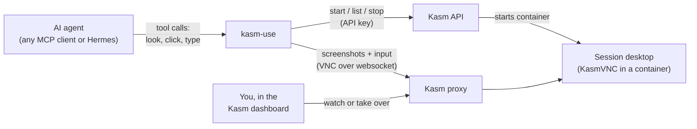

# kasm-use

<!-- mcp-name: io.github.rchurro/kasm-use -->

Let an AI agent use a [Kasm Workspaces](https://kasmweb.com) desktop: start a session, look at the
screen, click, type, press keys, scroll, and stop it — in plain language, from any MCP client
(Claude Code, Claude Desktop, OpenCode, Cursor, …) or as a native [Hermes Agent](#hermes-agent) plugin.

Other Kasm MCP servers manage sessions (start, list, stop). **kasm-use actually uses them**: the agent
sees the desktop and operates it, like computer-use or browser-use, inside your Kasm.

- **Works with stock Kasm images.** Nothing is baked into the workspace; it drives the desktop
  through Kasm's API and the session's own KasmVNC connection.
- **You can watch and take over.** Sessions are created as *your* Kasm user, so they show up in
  your Kasm dashboard. Open one to watch the agent work, or to handle a login or CAPTCHA yourself.
- **Your Kasm, your key.** You run the server next to your own Kasm. Nothing goes through a third party.

### What's Kasm?

[Kasm Workspaces](https://kasmweb.com) streams disposable desktops and apps to your web browser,
each running in its own container on a server you control. Click "Chrome" and you get a fresh
Chrome in a browser tab; close it and it's wiped. kasm-use lets an AI agent sit down at those
desktops and use them the way a person would.


*Demo (3x speed): Hermes Agent runs a three-session demo with kasm-use. Chrome, Terminal and
Minetest are started and driven in parallel while the Kasm dashboard shows each one live.*

How the pieces connect:



## Status: early — testers wanted

kasm-use works well on the setup it was built on (Kasm 1.19.0 in linuxserver's Docker image;
Chrome, Terminal and Minetest workspaces; Claude Code and Hermes Agent as clients). It talks to
parts of Kasm that aren't documented, so other versions and install types are the big unknown.
If you try it, please [open an issue](https://github.com/rchurro/kasm-use/issues/new/choose),
whether it worked or not: your Kasm version, how Kasm is installed, the workspace image and your
MCP client are the most useful details.

## Tools

| Tool | What it does |
| --- | --- |
| `kasm_list` | Workspaces you can start, and your running sessions |
| `kasm_start` | Start a workspace; returns its `state`, and `ready: true` once the desktop has drawn |
| `kasm_wait` | Wait until a session is ready; returns its state (`ready`, `preparing`, `queued`, `failed`) |
| `kasm_look` | Live screenshot of the session, returned as an image (~1 s) |
| `kasm_click` | Click at x,y in the latest screenshot's coordinates |
| `kasm_drag` | Drag from one point to another with the button held (menus, windows, sliders, drag and drop) |
| `kasm_type` | Type text into the focused field |
| `kasm_paste` | Paste text through the session clipboard: fast, exact for any characters. Needs **Allow Clipboard Up** for the user's Kasm group; KasmVNC does not confirm a clipboard, so check the result |
| `kasm_key` | Keys/shortcuts, e.g. `ctrl+l`, `Return`, `Tab`, `ctrl+plus`; the tool description lists every key name |
| `kasm_scroll` | Scroll, optionally at a point |
| `kasm_stop` | Destroy the session |

Set `verify_after: true` on `kasm_click`, `kasm_drag`, `kasm_type`, `kasm_key`, or `kasm_scroll` to return a fresh screenshot with the action result. Inspect the screenshot to decide whether the action worked. If the screenshot is unavailable, the input may still have been sent; call `kasm_look` before retrying.

## Requirements

- Kasm Workspaces **1.19 or newer** (tested on 1.19.0).
- A Kasm **API key**: Admin → Settings → Developers → API Keys → Add, then edit its permissions.
  kasm-use 0.3 needs exactly these five (tested end to end with a key that has only these):

  - **Images View**, **User**, **Users Auth Session** — starting sessions (without them `kasm_start`
    fails with `Unauthorized`).
  - **Sessions View** — session status and `kasm_list`.
  - **Sessions Delete** — `kasm_stop`.

  It no longer calls Kasm's exec API (**Sessions Modify**) or screenshot API (**Session Recordings
  View**), so you can remove those if you granted them for 0.2 or earlier. A missing permission shows
  up as `Unauthorized` from the tool that needs it. Read [Security model](#security-model) first:
  these permissions are server-wide.
- Your Kasm **user ID**, so sessions belong to you: Admin → Access Management → Users → open your user;
  the ID is in the page URL.
- Any workspace image. Nothing is installed in the session for sessions kasm-use starts.

## Configuration

| Variable | Required | Meaning |
| --- | --- | --- |
| `KASM_API_URL` | yes | e.g. `https://kasm.example.com` |
| `KASM_API_KEY` / `KASM_API_KEY_SECRET` | yes | the API key pair |
| `KASM_USER_ID` | yes | the Kasm user sessions are created for |
| `KASM_VERIFY_TLS` | no | `false` to accept a self-signed Kasm certificate (default `true`) |
| `KASM_SESSION_STATE_FILE` | no | private JSON file for reconnecting to tracked sessions after a kasm-use restart; stores no login tokens; several client processes may share one file (each save locks it and merges) |
| `KASM_USE_TOKEN` | HTTP only | bearer token clients must send |
| `KASM_WORKSPACE_ALLOW` | no | comma-separated workspace names, e.g. `Ubuntu Noble,Chrome`; `kasm_list` shows only these and `kasm_start` refuses the rest. Unset allows every enabled workspace |
| `KASM_USE_SCREEN` | no | `WIDTHxHEIGHT` (each 640–2560) asked of every new desktop when it starts, e.g. `1280x800`; unset keeps the image's size (usually 1024x768). A browser that opens the session still resizes it to its window |
| `KASM_PILOT_WORKSPACE_ID` | no | image ID of one workspace whose desktops are prepared by an outside controller (see [Slow-starting workspaces](#slow-starting-workspaces)) |
| `KASM_SESSION_STATUS_DIR` | no | directory where that controller publishes `<session_id>.json` for each of that workspace's sessions |
| `KASM_STATUS_WORKSPACE_IDS` | no | comma-separated image IDs of further workspaces whose sessions read status files from the same directory (a second controller) |

For restart recovery, use an absolute path in a directory owned by the kasm-use OS user with mode `0700`. The state file is created as mode `0600`. Use a separate file for each kasm-use process.

## Run it

### Locally (stdio) — the usual way

Your MCP client starts the server itself. With [uv](https://docs.astral.sh/uv/) installed:

```json
{
  "mcpServers": {
    "kasm": {
      "command": "uvx",
      "args": ["kasm-use"],
      "env": {
        "KASM_API_URL": "https://kasm.example.com",
        "KASM_API_KEY": "…",
        "KASM_API_KEY_SECRET": "…",
        "KASM_USER_ID": "…"
      }
    }
  }
}
```

Claude Code:

```bash
claude mcp add kasm -e KASM_API_URL=https://kasm.example.com -e KASM_API_KEY=… -e KASM_API_KEY_SECRET=… -e KASM_USER_ID=… -- uvx kasm-use
```

### As a service (streamable HTTP)

```bash
docker run -d -p 8000:8000 \
  -e KASM_API_URL=https://kasm.example.com -e KASM_API_KEY=… -e KASM_API_KEY_SECRET=… \
  -e KASM_USER_ID=… -e KASM_USE_TOKEN="$(openssl rand -hex 32)" \
  ghcr.io/rchurro/kasm-use:latest
```

Clients connect to `http://host:8000/mcp` with the header `Authorization: Bearer <KASM_USE_TOKEN>`.
Health check: `GET /healthz`. Run **one replica** per Kasm user: the server remembers each
session's last screenshot size in memory to map click coordinates.

Keep it on a private network (LAN, VPN, Tailscale). Anyone with the token can drive your desktops.

### Hermes Agent

```bash
pip install kasm-use                      # into Hermes's Python environment
cp -r hermes-plugin/kasm ~/.hermes/plugins/kasm
```

Enable `kasm` under `plugins.enabled`, set the environment variables above, and start a new
Hermes session (`/new`) so the tools load.

## Safety

An agent with these tools drives a real desktop on your network, so treat it like handing someone
your mouse and keyboard.

- **Use throwaway workspaces.** Don't let the agent work in a session that's logged into your
  real accounts, and don't save passwords in workspace images it uses.
- **Web pages can talk to the agent.** Text on a page it visits can try to steer it (prompt
  injection). Keep a human watching for anything that matters.
- **Traffic comes from your network.** Whatever the agent browses comes from your Kasm host's IP
  address. Kasm's per-workspace VPN/egress settings can route it elsewhere.
- The tool descriptions tell the agent never to type passwords, MFA codes or payment details and
  to hand CAPTCHAs to you, but that is guidance to the model, not enforcement.

## Security model

Two Kasm facts shape what kasm-use can and can't promise:

- **A Kasm API key is server-wide, not per user.** Kasm has no way to limit a key to one user.
  With the permissions above it can see and stop any user's sessions, and **Users Auth Session**
  ("login on behalf of another user") lets it get a login for any user.
- **The token `request_kasm` returns is a login for `KASM_USER_ID`, not for one session.** It opens
  every session that user has (verified on Kasm 1.19.0: a token from one session opened another
  session of the same user over VNC).

So the boundary is kasm-use itself:

- **Every tool only acts on sessions this kasm-use instance tracks.** By default, that is sessions
  started since process start. To recover across restarts, set `KASM_SESSION_STATE_FILE` to a file in
  an owner-only directory; it records session IDs and display metadata, never login tokens, and is
  bound to `KASM_USER_ID`. Any other `session_id` is refused, including for `kasm_look` and `kasm_stop`.
- If VNC rejects a login, kasm-use asks Kasm for a fresh connection URL, checks that it names the
  same session and owner, then retries the connection once before sending any input.
- **The model never sees the API key or any token**, only the nine tools.
- **No exec, no screenshot API.** kasm-use doesn't use Kasm's exec API (which can run commands in a
  session as root) or its screenshot API, so it doesn't need those permissions.

What that means for you:

- **Treat the API key like an admin credential**, and run kasm-use only on a machine you trust.
  Anyone who gets the key gets your Kasm, whatever kasm-use's code does.
- **Give the agent its own Kasm user** and set `KASM_USER_ID` to it. That keeps the agent's sessions
  and tokens away from your own sessions if something goes wrong in kasm-use. (It is a seatbelt,
  not a wall: the key itself can still reach every user.)
- **Kasm's disposability helps, but only so much.** Sessions are thrown away when they end (unless
  you enable persistent profiles), so nothing an agent does survives the session. The exposure is in
  sessions that are still running: one that's logged into an account, or that you're working in.
- **There's no per-action policy yet** (rate limits, blocked keys, "ask the human first"). Input goes
  straight to VNC once the scope check passes. VNC only sees pixels and keystrokes, so rules like
  "never type into this window" can't be enforced at this layer.

## Limitations

- **Restart recovery is opt-in.** Without `KASM_SESSION_STATE_FILE`, sessions from an earlier
  process remain outside kasm-use's allowlist. With it, kasm-use can recover sessions recorded after
  Kasm returned their IDs; an interruption before that record is written can still leave a session
  for you to stop from the Kasm dashboard.
- **Input reports "sent", not "succeeded".** The next screenshot is the confirmation.
- **CAPTCHAs, passwords, MFA and payments are handed to you.** The tool descriptions tell the agent
  never to type them; open the session in Kasm and take over.
- It's slow compared to a local browser tool: every step is a screenshot round trip.

## How it works

### Windows Server Workspaces

Install the optional `kasm-use[guac]` extra and run
`python -m playwright install chromium` in the same environment. For Docker,
build with `--build-arg INSTALL_GUAC=1`.

Configure the RDP workspace to use Kasm's web client and supply a per-session
RDP identity through the Kasm Server configuration. When the client is user
selectable, `kasm_start` requests Guacamole. The desktop tools open Kasm's
authenticated browser connection for the exact user and session they track.
The connection link is kept in memory. If Kasm displays an RDP login form,
complete login through the owner's Kasm browser. The tools do not collect
Windows passwords. Horizontal scroll sends Shift+wheel. Use the application's scrollbar if it
does not support that shortcut.

Typing goes at about 25 characters a second, and the first click or keystroke after kasm-use
attaches to the desktop is held for a few seconds: Windows drops faster or earlier input. There is
no clipboard on this transport, so `kasm_paste` is refused; `kasm_type` handles any character.
After a reconnect Windows Terminal can keep showing its old contents until its window is resized
(maximise it with `super+up`); other applications repaint by themselves.

### macOS guests

A macOS desktop served by QEMU's VNC server (for example a Dockur guest) works through a Server
(VNC) workspace or through a viewer container. QEMU's VNC presses the key a character sits on and
never adds Shift, so `kasm_type` holds Shift itself for capitals and shifted symbols; it does this
on every desktop, because it is what a keyboard sends. Use `cmd` and `option` in `kasm_key`
(`cmd+space` opens Spotlight). The mouse wheel does not reach the guest: scroll with `page_up` and
`page_down`. Nothing links the clipboard, so use `kasm_type`, not `kasm_paste`. Measured on macOS
Sequoia 15 with kasm-use 0.5.4.

### Slow-starting workspaces

Kasm reports a session as running as soon as its container is up. Most desktops draw within a few
seconds: `kasm_start` waits up to 20 s for the first non-blank frame and returns `ready: true`, and
`kasm_look` says so when the screen is still blank.

Some workspaces are only a viewer for something that takes minutes to prepare (a virtual machine
that has to boot, for example). For one such workspace, set `KASM_PILOT_WORKSPACE_ID` to its image
ID and `KASM_SESSION_STATUS_DIR` to a directory its controller writes to. List the image IDs of
any further such workspaces in `KASM_STATUS_WORKSPACE_IDS`. For each session the
controller publishes `<session_id>.json` (the 32-character ID, no dashes):

```json
{"session_id": "…", "phase": "preparing", "detail": "Signing in", "typing": "ascii", "updated": 1700000000.0}
```

`phase` is `queued`, `preparing`, `ready` or `failed`. `typing` is `ascii` when the desktop can only
receive ASCII keystrokes, otherwise `unicode`. While the phase is `queued` or `preparing`, `kasm_look`
and the input tools refuse with an error that names the state and points to `kasm_wait`; `failed`
returns the controller's `detail`. A file that is missing, unreadable or malformed counts as
`preparing` for the first 60 s of the session and as `failed` after that, so a controller that is
down does not leave an agent waiting forever. `kasm_stop` works in every state. Sessions of every
other workspace ignore the directory.

### Session lifetime

Kasm destroys a session when its keepalive runs out. Only a viewer's browser tab renews it, so a
session that just an agent uses would vanish mid-task. Measured on Kasm 1.19.0 on 2026-11-26 with
the default **Keepalive Expiration of 3600 s** (read from the session's `keepalive_date` and
`expiration_date`): an Ubuntu session started by the agent and then left alone was gone a few
minutes after the hour. The group's session time limit could not be read without admin access and
was not reached in that hour.

kasm-use therefore renews the keepalive whenever a tool connects to a session, at most every five
minutes per session. It uses the call Kasm's web client makes, `POST /api/keepalive` with the
session user's login token, the same token it already uses for VNC. Kasm's public
`/api/public/keepalive` was refused (HTTP 403) for an API key with the permissions listed under
Requirements, so no extra permission is needed or used. A renewal that fails does not fail the tool
call; it is tried again on the next one. A session nobody touches for an hour still expires, which
is what cleans up after an agent that forgets `kasm_stop`.

### Container Workspaces

kasm-use talks to each session's KasmVNC server directly, through Kasm's own proxy
(`wss://<kasm>/desktop/<id>/vnc/websockify`), with the login token `request_kasm` returns.
The VNC client is built in and uses only the Python standard library.

- **Eyes:** a full framebuffer read over VNC (ZRLE, decoded with `zlib`), returned as PNG.
  Kasm's screenshot API isn't used for these sessions: it only refreshes while a viewer is
  connected, so with nobody watching it returns stale frames.
- **Hands:** VNC pointer and key events. KasmVNC's pointer message is 11 bytes (16-bit button
  mask plus scroll deltas), not standard RFB's 6.
- Clicks are given in screenshot pixels and scaled to the desktop's current size, which VNC reports
  on connect — it changes when someone opens the session and Kasm resizes it to their window.
- Each tool call opens a short VNC connection and does a round trip before closing, so no input
  is lost on disconnect. If Kasm rejects an expired login token, kasm-use refreshes it and retries
  the connection once; it never retries the input action. The owner can stay connected at the same time.

**What this relies on.** None of this is an official Kasm API; it's how Kasm's own web viewer
connects, observed on Kasm 1.19.0:

- Kasm's proxy accepts the `username` + `session_token` cookies that `request_kasm` returns, and
  requires an `Origin` header matching the Kasm host.
- Behind the proxy, KasmVNC offers VNC authentication and accepts an empty password (the proxy
  has already authenticated you).
- KasmVNC's pointer message is 11 bytes (visible in its open-source web client).

A Kasm update or a different install type could change any of these. If kasm-use stops
connecting, that's the likely cause, and an issue with your Kasm version and install type helps.

## License

MIT
